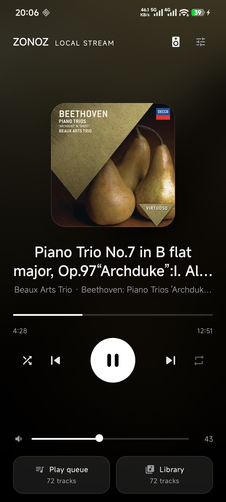
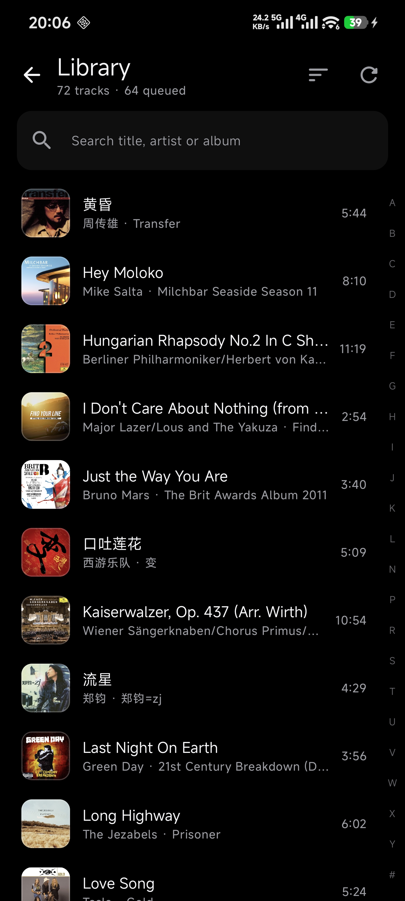
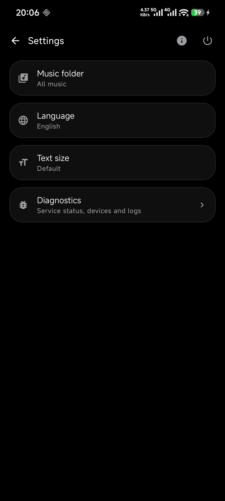
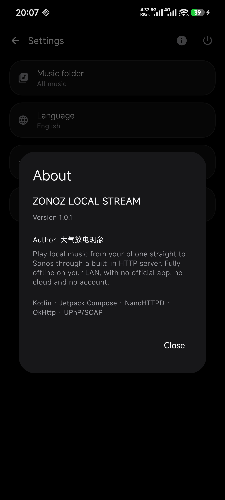

# ZONOZ LOCAL STREAM

把手机里的本地音乐，通过 **App 自建的 HTTP 服务 + 直连音箱的 UPnP/SOAP**，推给局域网里的 Sonos 播放。

全程离线、纯局域网：不经过任何云端，不需要账号，也不依赖 Sonos 官方 App。
适合家里有 Sonos 音箱、但音乐都存在手机本地的场景。

```
手机 App（NanoHTTPD :8080） ──SetAVTransportURI(URL)──► 音箱 :1400 /AVTransport
        ▲                                                   │
        └─────────────  GET /stream/<id>（Range 206） ───────┘
```

> 本项目是非官方工具，与 Sonos, Inc. 无任何关联。"Sonos" 仅用于说明兼容的设备。

---

## Screenshots / 应用截图

| Player | Library | Settings | About |
| :---: | :---: | :---: | :---: |
|  |  |  |  |

## 功能

- **本地曲库**：扫描手机音乐目录（Android 11+ 走 SAF，未入库的文件也能读到），支持搜索、A-Z 索引、按标题/时间/大小/时长排序
- **推流播放**：手机当媒体服务器，音箱拉流播放；完整支持 HTTP Range，可拖动进度
- **播放清单**：真实播放顺序，点哪首播哪首；随机 / 列表循环 / 单曲循环三者严格互斥
- **收藏**：长按曲目加入喜爱，可筛选只看收藏
- **锁屏续播**：本地计时器 + 精确闹钟双保险，锁屏/息屏也能自动接下一首
- **通知与锁屏**：系统媒体卡片，专辑图右下角带品牌角标
- **多语言**：简体中文 / 繁體中文 / English / 日本語 / 한국어 / Русский / Español / Français（8 套）
- **界面**：纯黑主题、整体文字大小四档、点击与拖动触感反馈
- **设备**：自动发现局域网音箱，识别主箱/卫星箱，支持 S1 / S2 固件

## 环境要求

| 项 | 版本 |
| --- | --- |
| Android | 8.0 (API 26) 及以上 |
| 编译 SDK | 35 |
| JDK | 17 |
| Gradle | 8.9（仓库自带 wrapper） |

## 构建

```bash
git clone <你的仓库地址>
cd ZONOZ-LOCAL-STREAM/SonosLocalCast

# 1) 告诉 Gradle SDK 在哪（或直接用 Android Studio 打开，会自动生成）
echo "sdk.dir=/path/to/Android/Sdk" > local.properties

# 2) 打 debug 包
./gradlew assembleDebug

# 3) 产物
#    app/build/outputs/apk/debug/app-debug.apk
```

release 包需要签名。把 keystore 放到 `SonosLocalCast/keystore/`，然后在 `local.properties` 里写：

```properties
signing.storeFile=../keystore/your.jks
signing.storePassword=***
signing.keyAlias=***
signing.keyPassword=***
```

没有 keystore 时 `assembleRelease` 仍会产出**未签名**的 APK，装不上而已，不影响编译。

生成一个自己的 keystore：

```bash
keytool -genkeypair -v -keystore your.jks -alias yourkey \
        -keyalg RSA -keysize 2048 -validity 10000
```

## 使用

1. 安装后打开，允许「音乐和音频」权限
2. `设置 → 音乐文件夹` 选一个目录（默认 `Music`）
3. 回到播放页，点右上角音箱图标，等自动发现；没发现就手动输入音箱 IP
4. 进曲库点一首歌 → 音箱开始播放
5. 想锁屏也能连续播放：`设置 → 调试 → 后台保活`，按提示关掉电池优化、允许精确闹钟

## 已知限制

- **仅限局域网**：手机和音箱必须在同一个 Wi-Fi；路由器开了「AP 隔离」会失败
- **明文 HTTP**：音箱只支持 HTTP，所以 App 声明了 `usesCleartextTraffic`，全部流量留在局域网内
- **不做 Sonos 原生队列**：一首一首推，歌与歌之间可能有 1~2 秒空隙（原生队列是后续计划）
- **不支持音箱分组**（`x-rincon`）
- **S1 老固件**只做了识别与降级，没有真机验证过
- 只处理本地音频文件，不接流媒体服务

## 隐私

- 没有账号、没有统计、没有崩溃上报，App 不发任何外部网络请求
- 唯一的网络行为：局域网内 SSDP 发现 + 对音箱的 SOAP 控制 + 作为 HTTP 服务端把音频发给音箱
- 曲库信息只在本机内存与 SharedPreferences 里

## 项目结构

```
SonosLocalCast/                 Android 工程（包名 com.sonoscast.local，沿用历史命名）
├── app/src/main/java/com/sonoscast/local/
│   ├── core/                   协议与基础能力（HTTP 服务、SOAP、SSDP、曲库、i18n…）
│   ├── service/                前台服务与续播闹钟
│   └── ui/                     Compose 界面
└── app/src/main/res/
tools/make_icons.py             图标生成脚本（白底黑字 ZONOZ）
.vscode / .github/              构建 CI
```

## 致谢与许可

MIT License，见 [LICENSE](LICENSE)。
第三方库：AndroidX / Jetpack Compose / Kotlin 协程 / [NanoHTTPD](https://github.com/NanoHttpd/nanohttpd) / [OkHttp](https://square.github.io/okhttp/)。

作者：**大气放电现象**
